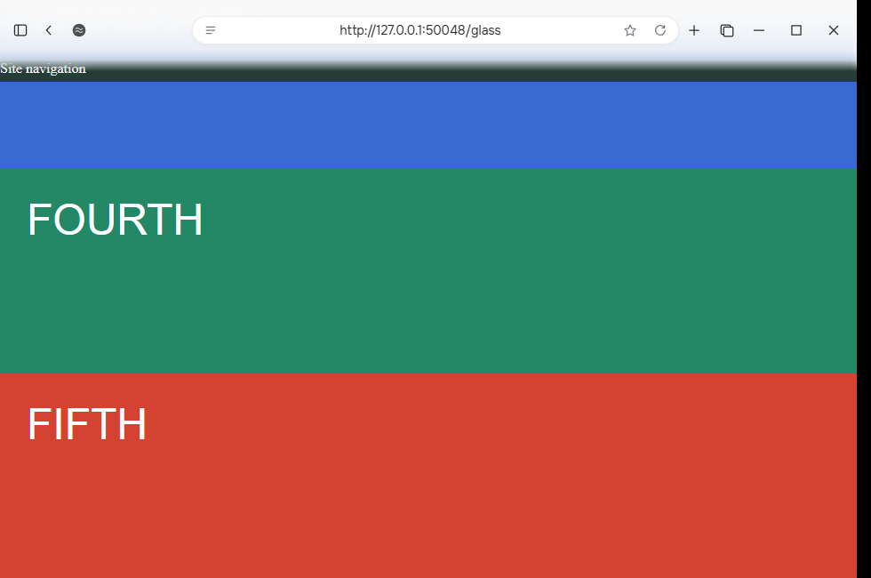
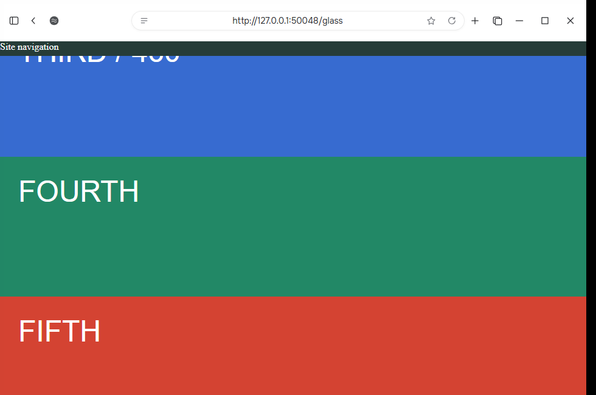

# Page glass native preview

Experimental implementation based on beta 1.0.66. Not published as a release.

Windows visual test: https://github.com/sanderstripa/soulu/actions/runs/40771552082

Verified with the compiled experimental executable: native content starts 68 px below chrome; scrolling changes the live backdrop; fixed site navigation remains below chrome; header clicks do not reach the page; feathered edge passes page clicks; disabling matte gives an opaque white panel; toggling preserves the page instance.

These are real screenshots of the native browser with a diagnostic page. General site compatibility, dark theme, multiple tabs, resizing and full release regressions still need validation before shipping.

