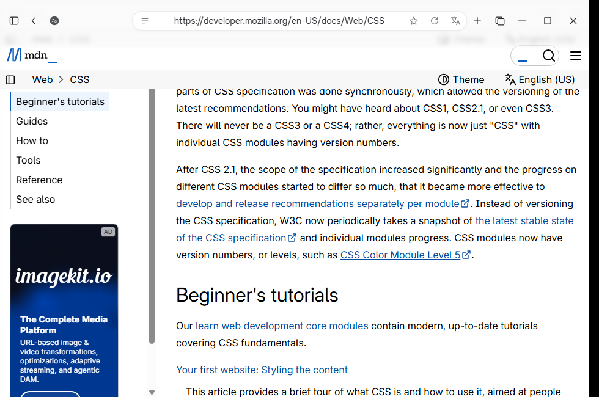
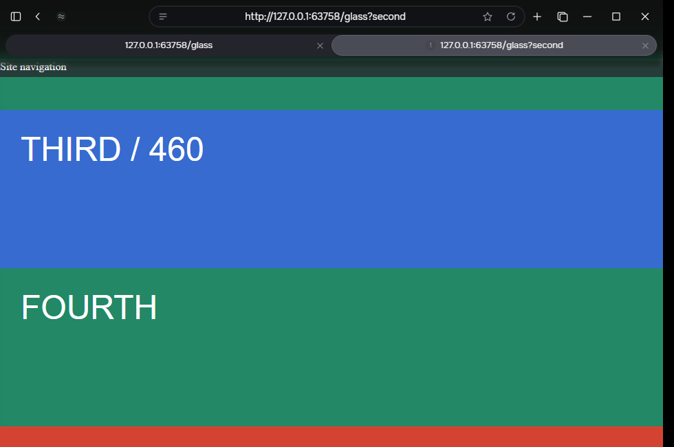
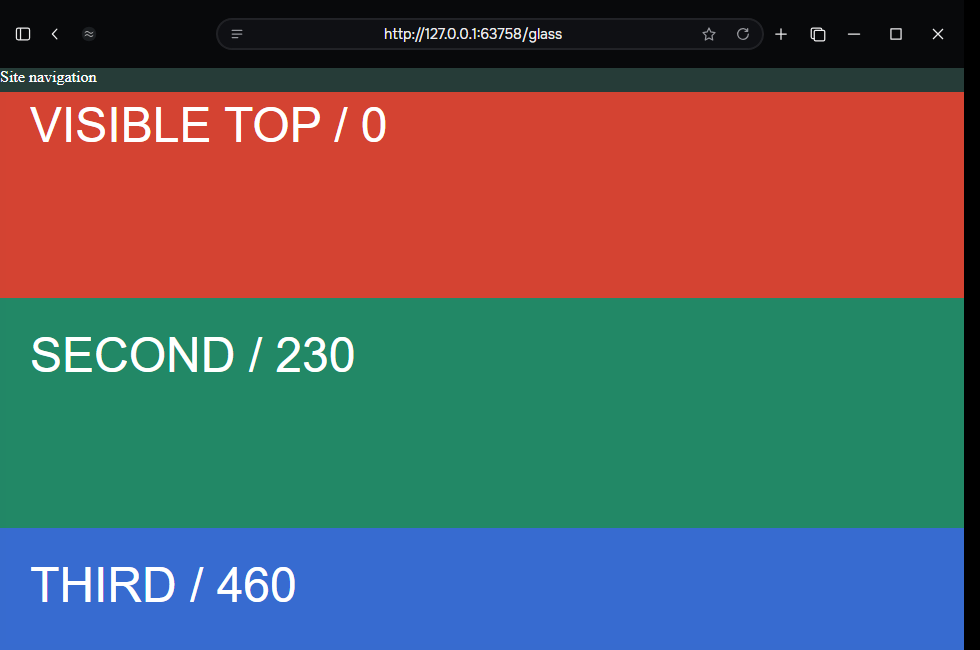
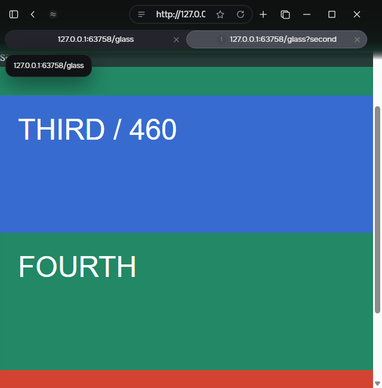
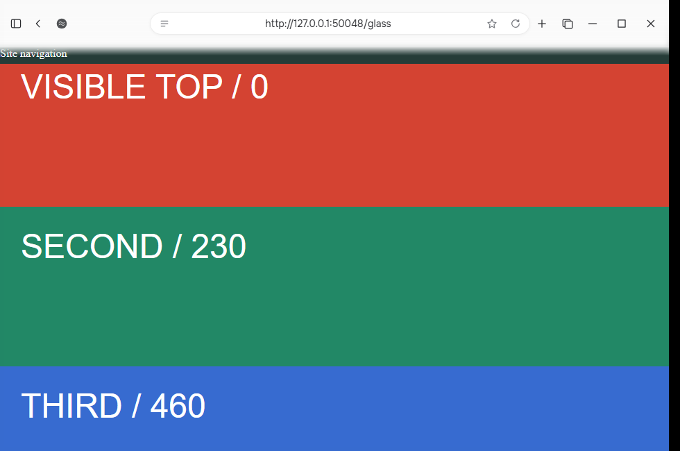
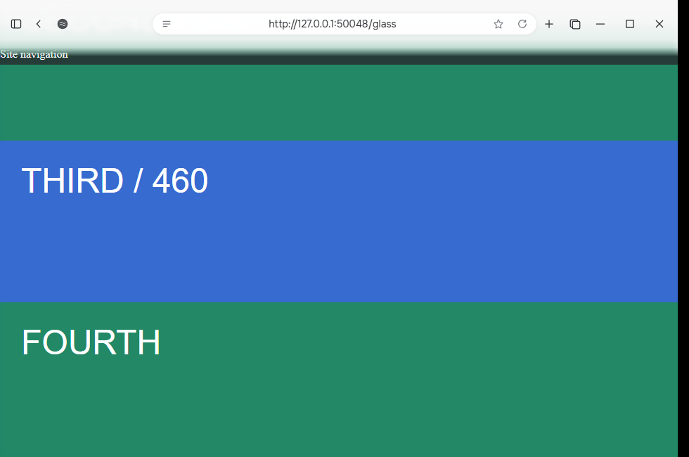

# Native page glass preview

Experimental implementation based on beta 1.0.66; no release was published.

The live webpage paints beneath a native blur/tint composition layer. Website content initially starts below the toolbar, then enters the glass when scrolling. Matte off uses a fully opaque toolbar. Existing page instances remain alive across toggles and tab transitions.

## Windows validation

- [Fresh native build and initial visual test](https://github.com/sanderstripa/soulu/actions/runs/40771343188): successful.
- [Extended validation and existing regression suites](https://github.com/sanderstripa/soulu/actions/runs/40811164252): successful, using the compiled experimental binary. The workflow verifies that native and UI source are identical to the compiled candidate before execution; unchanged pinned CEF runtime files come from 1.0.66.
- Initial native content offset: 68 px. Fixed navigation offset: 68 px with one tab and 88 px with two tabs.
- Live glass pixels change with the actual document. Toolbar blocks clicks to hidden page content; the feathered edge passes clicks to visible page content.
- Matte off is opaque in light and dark themes.
- Both layouts, 640/980 px windows, tab switching and close preserve document identity and scroll position.
- example.com, Wikipedia and MDN load and retain their document when toggling matte.
- Existing toolbar controls, native drag/minimize/maximize/close, popup bounds and emulated raster scales pass.
- Adaptive expansion/collapse, active title and close at narrow widths, pinned tabs, profiles, incognito and normal restart pass.
- Storage/restart regression passes.

Tests ran on Windows 2025 hosted desktop. Physical multi-monitor DPI changes and arbitrary site-specific layouts are not exhaustively covered. The product version remains 1.0.66 until an approved release is prepared.

## Real browser screenshots

MDN during scrolling:

Dark mode with two tabs:

Matte disabled in dark mode:

Narrow window:

Diagnostic initial page:

Diagnostic live glass:

